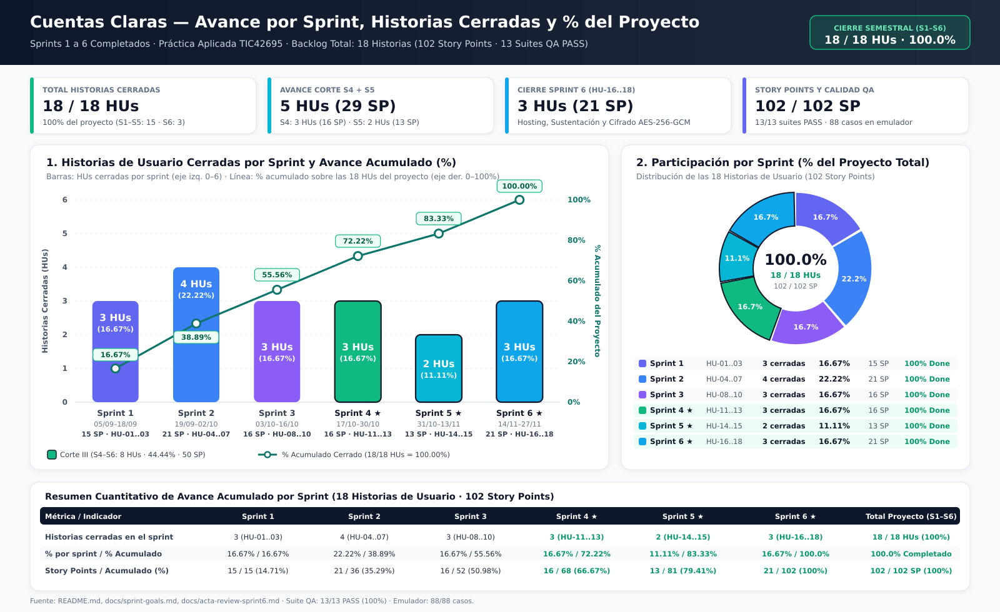

# Entrega y Guion de Sprint Review — Sprints 4 y 5

**Proyecto:** Cuentas Claras — Plataforma Web para la Gestión de Finanzas Compartidas en el Hogar  
**Asignatura:** Práctica Aplicada (`TIC42695`) · Ingeniería de Sistemas · Semestre 2026-2  
**Docente / Stakeholder Evaluadora:** Vilma Yenny Bohórquez  
**Fecha de Corte Documentado:** 13 de noviembre de 2026 (consolidación final en `main` y verificación QA: 14 de noviembre de 2026)  
**Repositorio GitHub:** [Cuentas-Claras.git](https://github.com/cuentaclaras672-boop/Cuentas-Claras.git)  
**Tablero de Gestión (Scrum/Kanban):** [Tablero en Miro](https://miro.com/welcomeonboard/YVBLdkdFZm96Ujdjb2tKRFFuZVA2QUQrOVdFbDc2dzRHU0tZT0hvRG1lVVNiSVNISHJyNVJZbFJyeHBRZUYzaEFqcnFuQWhJZzlBeExhYTVhUTlpdjB4SGhFS2dFNjFZcjlwNHpIa3pXblhlbVRYam1ERGtKMnpDSzhINDFZWUtyVmtkMG5hNDA3dVlncnBvRVB2ZXBnPT0hdjE=?share_link_id=694372715874)  
**Gráfica de Avance:** [grafica-avance-sprints-4-5.png](grafica-avance-sprints-4-5.png) · [grafica-avance-sprints-4-5.svg](grafica-avance-sprints-4-5.svg)  
**Presentación Interactiva para Video / PDF:** [presentacion-review-sprints-4-5.html](presentacion-review-sprints-4-5.html)  
**Diapositivas para el video (29, con notas del orador):** [Review Sprints 4 y 5 — Cuentas Claras](https://claude.ai/artifact/TcU2QDeGfaE3NdCsubG9mA)  
**Guion por integrante:** [guion-review-sprints-4-5.md](guion-review-sprints-4-5.md)

---

## 1. Equipo Scrum y Participación Identificada (Requisito #1 y #2)

| Integrante | Rol Scrum / Técnico | Aporte en Sprint 4 (`17/10 – 30/10`) | Aporte en Sprint 5 (`31/10 – 13/11`) | Participación en Video Review (52 min) |
|---|---|---|---|---|
| **Juan Diego Peraza Amado** | Product Owner / Desarrollo Frontend | Tarea `12.3` (categorías dinámicas en formulario), revisión arquitectónica y conducción de Review S4. | Tarea `15.3` (`@media print` y `.only-print`), `normalizarFecha()`, regla SDK `10.13.0` en DoD y consolidación final de `14.2`, `15.1`, `15.2` en `main`. | Apertura, contexto Product Goal, demo **HU-12 / HU-13** y vista impresión PDF (**HU-15**), y cierre hacia Sprint 6. |
| **Fabián Eduardo Córdoba** | Scrum Master / QA Lead | Facilitación Dailies, control WIP/DoD, Tareas `11.4` y `13.2` (`pruebas-liquidaciones.test.js`), Informe QA S4. *(Ausencia justificada el 30/10).* | Facilitación Dailies/Retro S5, diseño QA carga/estrés `14.2` (`pruebas-seguridad-carga.test.js`), certificación `tests/runner.js` (12/12 PASS) e Informe QA S5. | Tablero Miro, métricas y **Gráfica de Avance**, ejecución en vivo de `node tests/runner.js`, impedimentos organizativos y moderación de preguntas. |
| **Daniel Felipe Cortes** | Development Team / Infraestructura y Servicios | Tareas `11.2` (`liquidaciones.js`, `runTransaction`), `12.2` (reglas `categorias`), `13.1`, y suplencia SM/Demo en Review S4. | Tareas `14.1` (auditoría `firestore.rules` 6 colecciones, 46 casos en emulador), `14.3` (`conexion.js` + reintentos en 5 servicios), cableado `dashboard.js` (`321b5f6`) y adelanto Hosting `14.4` / `16.1–16.2`. | Demo técnica de **HU-14** (reglas en `firestore.rules`, reporte de 46 casos en emulador, desconexión Offline F12) y riesgos técnicos. |
| **Jorman Palacios Murillo** | Development Team / UI & UX | Tareas `11.3` (panel de cuadre mensual en dashboard) y `13.1` (`maxlength="120"` y contador en vivo). *(Ausencia justificada el 30/10).* | Tarea `15.2` (diseño de botones `#btn-exportar-csv` e `#btn-imprimir-reporte` en cabecera del historial y limpieza visual de impresión). | Demo en vivo de interfaz **HU-11** (panel Mi Hogar + Cuadre Mensual) y **HU-13** (contador dinámico), más botones de reporte **HU-15**. |
| **Yerson Niño Guerrero** | Development Team / Dominio y Datos | Tareas `11.1` (algoritmo Greedy `src/utils/cuadre.js`) y `12.1` (servicio CRUD `src/services/categorias.js`). *(Ausencia justificada el 30/10).* | Tarea `15.1` (especificación y lógica CSV RFC 4180 con BOM UTF-8 y prevención de inyección de fórmulas en `src/utils/exportador.js`). | Explicación del algoritmo Greedy (**HU-11**), exportación y apertura real del archivo **CSV RFC 4180** (**HU-15**), y preguntas de valor/aprendizaje. |

> **Nota de trazabilidad sobre Sprint 4:** En la sesión presencial de cierre del 30 de octubre (`docs/acta-review-sprint4.md`), Fabián Córdoba, Jorman Palacios y Yerson Niño presentaron ausencia justificada por fuerza mayor y fueron suplidos en vivo por Juan Diego Peraza y Daniel Cortes bajo propiedad colectiva del código. En el **video de esta Review combinada (Sprints 4 y 5)**, los **5 integrantes participan activamente** demostrando tanto sus contribuciones de Sprint 4 como las de Sprint 5.

---

## 2. Impacto de los Sprints 4 y 5 en el Product Goal

> **Product Goal del Proyecto (`README.md`):**  
> *"Lograr que las parejas y usuarios individuales centralicen la gestión de sus compromisos financieros (gastos compartidos, metas de ahorro y control de préstamos a terceros), reduciendo el estrés y el tiempo de cuadre de cuentas a menos de 5 minutos semanales, y logrando un registro activo de al menos el 80% de sus movimientos financieros al finalizar las 16 semanas del semestre."*

| Sprint | Periodo | Sprint Goal | Contribución Directa al Product Goal | Resultado |
|---|---|---|---|---|
| **Sprint 4** | 17/10/2026 – 30/10/2026 | *"Que los convivientes del hogar puedan cuadrar cuentas al final del mes sabiendo exactamente quién le debe a quién con transferencias mínimas y marcar el mes como saldado de forma atómica en Firestore, gestionando categorías personalizadas y garantizando la integridad de los datos financieros con descripciones controladas."* | Materializa la promesa núcleo del producto: elimina el cálculo manual y las discusiones de *"¿quién puso qué?"* reduciendo la conciliación mensual a segundos, adapta las categorías al estilo de vida del hogar y evita desbordes de datos. | **100% Cumplido** (`3/3 HUs` · `16/16 SP` · `8/8 tareas`) |
| **Sprint 5** | 31/10/2026 – 13/11/2026 | *"Realizar la auditoría de seguridad integral, pruebas de resiliencia y pruebas de carga sobre Cloud Firestore y Firebase Auth, incorporando la exportación de reportes financieros del hogar (formato estructurado CSV / PDF imprimible) para garantizar la robustez del sistema de cara al cierre de semestre."* | Garantiza que los datos financieros del hogar estén blindados contra accesos o manipulaciones no autorizadas (Condición #2), no se pierdan ante caídas de Internet (Condición #5) y puedan respaldarse en Excel/PDF (Condición #4). | **100% Cumplido** (`2/2 HUs` · `13/13 SP` · `6/6 tareas base + anexo 14.4`) |

---

## 3. Evidencia Detallada de Historias Trabajadas y Terminadas (Requisito #3)

### 3.1 Sprint 4 — Conciliación del Hogar, Categorías e Integridad (16 SP · 3 HUs)

#### [HU-11] Cuadre mensual de gastos y liquidación entre convivientes (8 SP · Prioridad 1)
- **Condiciones Técnicas Reforzadas:** #1 (Persistencia Real y atomicidad con `runTransaction`) y #2 (Control de Acceso y aislamiento por hogar).
- **Implementación Real en el Repositorio:**
  - **Capa Transversal ([`src/utils/cuadre.js`](../src/utils/cuadre.js)):** Función pura `calcularCuadreMes(gastosCompartidos, miembros)` que suma aportes por miembro, calcula la cuota equitativa (`totalGastos / miembros.length`), obtiene balances (`pagado - cuota`) y aplica un **algoritmo codicioso (Greedy)** ordenando deudores y acreedores ($O(N \log N)$) para generar como máximo **$N - 1$ transferencias** (tope de 5 transferencias en hogares de hasta 6 convivientes).
  - **Capa de Infraestructura ([`src/services/liquidaciones.js`](../src/services/liquidaciones.js)):** Escucha reactiva en tiempo real (`escucharGastosCompartidosDelPeriodo` y `escucharLiquidacion`) con uso de `normalizarFecha()`, ID determinista `{hogarId}_{AAAA-MM}` (`idLiquidacion`), y `marcarLiquidacionSaldada()` protegida con `asegurarConexion()`, `conReintentos()` y `runTransaction` idempotente (si dos convivientes pulsan al tiempo, solo se crea una liquidación).
  - **Capa de Presentación ([`public/index.html`](../public/index.html) y [`src/ui/dashboard.js`](../src/ui/dashboard.js)):** Selector de periodo `#select-periodo-liquidacion` (`type="month"`), panel `#contenedor-cuadre-hogar` con desglose por conviviente (*pagó*, *le deben / debe / al día*), lista de transferencias mínimas y botón `#btn-marcar-saldado` con confirmación y badge **"Mes saldado"**.
  - **Seguridad en Servidor ([`firestore.rules`](../firestore.rules#L237-L262)):** `match /liquidaciones/{liquidacionId}` valida formato `{hogarId}_{AAAA-MM}`, pertenencia mediante `esMiembroDelHogar()`, `saldadaPor == request.auth.uid`, máximo 5 transferencias, `fecha == request.time`, y prohíbe `update` y `delete` (inmutabilidad auditable).
  - **Pruebas QA ([`tests/pruebas-liquidaciones.test.js`](../tests/pruebas-liquidaciones.test.js)):** Verificado en `node tests/runner.js` (**PASS**).

#### [HU-12] Categorías personalizadas por usuario (5 SP · Prioridad 2)
- **Condiciones Técnicas Reforzadas:** #1 (Persistencia Real) y #2 (Aislamiento estricto por UID).
- **Implementación Real en el Repositorio:**
  - **Capa de Infraestructura ([`src/services/categorias.js`](../src/services/categorias.js)):** CRUD con Firebase SDK `10.13.0` (`guardarCategoria`, `obtenerCategorias`, `actualizarCategoria`, `eliminarCategoria`), validación de longitud entre `3` y `40` caracteres, validación de autenticación y guarda `asegurarConexion()` en escrituras.
  - **Capa de Presentación ([`public/index.html`](../public/index.html#L635-L654) y [`src/ui/dashboard.js`](../src/ui/dashboard.js#L239-L259)):** Botón `#btn-crear-categoria` (`+ Nueva`) junto al selector de categoría en `#form-transaccion`, recarga automática vía `cargarCategoriasUsuario()` poblando tanto el formulario (`poblarCategorias`) como el filtro de historial (`poblarFiltroCategorias` en `#filtro-categoria`).
  - **Seguridad en Servidor ([`firestore.rules`](../firestore.rules#L50-L59) y [`firestore.rules`](../firestore.rules#L264-L275)):** Regla `esCategoriaValida()` y validación estricta `resource.data.uid == request.auth.uid` en lectura, creación, actualización y borrado.
  - **Pruebas QA ([`tests/pruebas-categorias.test.js`](../tests/pruebas-categorias.test.js)):** Verificado en `node tests/runner.js` (**PASS**).
  - *Nota honesta para stakeholders:* La UI permite crear y filtrar categorías personalizadas directamente desde el formulario; las operaciones de renombrar y eliminar están implementadas y blindadas en `src/services/categorias.js` y `firestore.rules` (validadas en `auditoria-reglas.mjs`), quedando la interfaz visual de gestión/edición de lista como posible mejora UX menor si el stakeholder la solicita.

#### [HU-13] Control de integridad y límite de descripción de transacciones (3 SP · Prioridad 3)
- **Condición Técnica Reforzada:** #5 (Manejo de Errores Visible y Validación en Cliente y Servidor).
- **Implementación Real en el Repositorio:**
  - **Capa de Dominio ([`src/models/Transaccion.js`](../src/models/Transaccion.js#L13)):** Constante exportada `MAX_DESCRIPCION = 120` y validación defensiva en `validar()` (mínimo 3, máximo 120 caracteres).
  - **Capa de Presentación ([`public/index.html`](../public/index.html#L579-L589) y [`src/ui/dashboard.js`](../src/ui/dashboard.js#L261-L272)):** Atributo `maxlength="120"` + `aria-describedby="contador-descripcion"` y listener en vivo que actualiza el contador de *"Quedan 120 caracteres"* hasta *"Queda 1 carácter"*.
  - **Seguridad en Servidor ([`firestore.rules`](../firestore.rules#L27)):** Validación espejo `d.descripcion.size() >= 3 && d.descripcion.size() <= 120`.
  - **Pruebas QA:** Validadas en `tests/pruebas-liquidaciones.test.js` dentro de `node tests/runner.js` (**PASS**).

---

### 3.2 Sprint 5 — Seguridad, Carga, Resiliencia y Exportación de Reportes (13 SP · 2 HUs + Acuerdos Retro S4)

#### [HU-14] Auditoría de seguridad, pruebas de carga y resiliencia en red (8 SP · Prioridad 1)
- **Condiciones Técnicas Reforzadas:** #2 (Control de Acceso y Aislamiento) y #5 (Manejo de Errores y Resiliencia).
- **Implementación Real en el Repositorio:**
  - **Endurecimiento de Reglas y Emulador ([`firestore.rules`](../firestore.rules), [`tests/emulador/auditoria-reglas.mjs`](../tests/emulador/auditoria-reglas.mjs), [`docs/auditoria-seguridad-sprint5.md`](auditoria-seguridad-sprint5.md)):**
    - Auditoría de las **6 colecciones** (`transacciones`, `bolsillos`, `prestamos`, `hogares`, `liquidaciones`, `categorias`) + regla por defecto `match /{document=**} { allow read, write: if false; }`.
    - Corrección de **13 brechas de seguridad** (entre ellas: `esBolsilloValido` con `hasOnly` y longitud 3–40 chars alineada en `src/models/Bolsillo.js` y `public/index.html`, `esCategoriaValida` en `update`, `esAbonoValido` en `prestamos` impidiendo reescribir abonos previos, límite `10¹²` y `nombreUsuario <= 100` en `transacciones`, y `nombres[uid] <= 60` en `hogares`).
    - Resultado en Emulador Firestore (ejecutado el 13/11/2026 por Daniel Cortes): pasó de **27/40** ataques bloqueados a **40/40 ataques bloqueados** con `permission-denied` y **6/6 flujos legítimos aprobados**.
  - **Resiliencia ante Caídas de Red ([`src/services/conexion.js`](../src/services/conexion.js) y 5 servicios):**
    - Clase tipificada `ErrorSinConexion`, guarda previa `asegurarConexion()` (corta escrituras offline antes de encolarlas en Firestore), detector `esErrorTransitorio()` (`unavailable`, `deadline-exceeded`, `aborted`, offline/fetch) y función `conReintentos()` con espera exponencial (`400 ms` inicial, máx. `4000 ms`, `3` intentos) aplicada en operaciones idempotentes en `firestore.js`, `hogares.js`, `liquidaciones.js`, `prestamos.js` y `categorias.js`.
    - Integración UI en `aplicarEstadoConexion()` (`dashboard.js`): banner `#banner-offline` visible y deshabilitación preventiva de botones de escritura, manteniendo operables lectura, filtros y exportación local.
  - **Pruebas de Carga, Estrés y Resiliencia ([`tests/pruebas-seguridad-carga.test.js`](../tests/pruebas-seguridad-carga.test.js), [`tests/pruebas-resiliencia.test.js`](../tests/pruebas-resiliencia.test.js)):**
    - Verificación estática de las 6 colecciones + `deny-all` en `firestore.rules`.
    - Ráfaga concurrente de **50 abonos atómicos** (ejecutada hoy en `1.54 ms < 500 ms`, 0 condiciones de carrera) y **50 cierres mensuales simultáneos** con idempotencia estricta (1 consolidado, 49 bloqueados).
    - Pruebas de corte de red, reintentos transitorios y rechazo inmediato de `permission-denied`.

#### [HU-15] Exportación de reportes financieros del hogar — CSV y vista imprimible (5 SP · Prioridad 2)
- **Condición Técnica Reforzada:** #4 (Consulta con Filtrado y Portabilidad).
- **Implementación Real en el Repositorio:**
  - **Serializador Puro RFC 4180 ([`src/utils/exportador.js`](../src/utils/exportador.js)):**
    - `CABECERAS_CSV`: `Fecha,Descripcion,Monto,Tipo,Ambito,Categoria,Autor`.
    - `escaparCampoCSV()`: escapado RFC 4180 (comas, comillas dobles `""`, saltos de línea) + **neutralización de *CSV Formula Injection*** anteponiendo apóstrofo `'` si un texto inicia por `=`, `+`, `-` o `@`.
    - `generarCSVTransacciones()`: saltos `\r\n` (CRLF) y **BOM UTF-8 (`\uFEFF`)** para apertura directa en Excel Windows sin dañar tildes ni `ñ`.
    - `nombreArchivoCSV()`: formato `cuentas-claras-reporte-AAAA-MM-DD.csv` usando `fechaLocalISO()`.
  - **Controles UI e Impresión PDF ([`public/index.html`](../public/index.html#L689-L712), [`src/ui/dashboard.js`](../src/ui/dashboard.js#L406-L468), [`public/style.css`](../public/style.css#L38-L127)):**
    - Botón `#btn-exportar-csv` conectado a `obtenerTransaccionesFiltradas()` (exporta exactamente los filtros activos y funciona incluso sin conexión a Internet).
    - Botón `#btn-imprimir-reporte` que puebla la cabecera `.only-print` (usuario, fecha de generación, filtros y divisa activa) y ejecuta `window.print()` con hoja `@media print` (oculta `.no-print`, cambia a fondo blanco/alto contraste y preserva legibilidad en PDF).
  - **Pruebas QA ([`tests/pruebas-exportador.test.js`](../tests/pruebas-exportador.test.js)):** Verificado en `node tests/runner.js` (**PASS**).

#### Cierre de Acuerdos Técnicos Retro S4 y Adelanto Hacia Sprint 6
- **Ancla 1 (`normalizarFecha()`):** Implementada en [`src/utils/formateo.js`](../src/utils/formateo.js#L46-L64) para unificar `Date`, `.toDate()`, `{ seconds }`, cadenas ISO y epoch; reutilizada en `formatearFecha()`, `liquidaciones.js`, `exportador.js` y `dashboard.js`.
- **Ancla 2 (Homogeneidad Firebase SDK `10.13.0`):** Incorporada en [`docs/definition-of-done.md`](definition-of-done.md#L50) y verificada en todos los módulos de `src/services/`.
- **Adelanto Operativo (`Tarea 14.4` / `16.1`–`16.2`):** Publicados [`.firebaserc`](../.firebaserc), [`firebase.json`](../firebase.json) y [`docs/guia-despliegue.md`](guia-despliegue.md).

### 3.3 Evidencia de Ejecución Verificada (Actualizada con Cierre de Sprint 6 y HU-18)

| Verificación | Comando Ejecutado | Resultado Observado | Alcance |
|---|---|---|---|
| **Suite Integral QA** | `node tests/runner.js` | **13 / 13 suites PASS (100%)**, 0 fallidas y 0 advertencias. Ráfaga 50 abonos en **0.67 ms** (`< 500 ms`), 0 race conditions; idempotencia 1/50; `normalizarFecha()`; resiliencia `conReintentos`; exportador RFC 4180; liquidaciones; categorías; **cifrado AES-256-GCM (`pruebas-cifrado.test.js`)**. | Sprints 2, 3, 4, 5 y 6 (sin dependencias de red). |
| **Sintaxis ES6 Modules** | `for f in src/*.js src/**/*.js tests/*.js; do node -c "$f"; done` | **0 errores de sintaxis** en todo `src/` y `tests/`. | Todos los módulos fuente y pruebas. |
| **Auditoría Emulador Firestore** | Registrada en `docs/auditoria-seguridad-sprint5.md` y `docs/cifrado-datos.md` | **46 casos en S5 → 88 / 88 casos en S6** (incluyendo 8 colecciones y cifrado AES-256-GCM de textos y montos). | Certificada en `tests/emulador/auditoria-reglas.mjs`. |

---

## 4. Dependencias, Impedimentos y Riesgos Evidenciados (Requisito #4)

| Tipo | Sprint / Fase | Descripción del Elemento | Evidencia / Impacto en la Entrega | Estado | Mitigación Aplicada o Planificada |
|---|---|---|---|---|---|
| **Impedimento** | Sprint 4 | **Ausencia justificada de 3 integrantes** en la Review presencial del 30/10/2026 (Fabián, Jorman, Yerson). | Riesgo de no poder sustentar módulos de dominio/UI/QA en la revisión parcial. | **Mitigado** | Juan Diego Peraza y Daniel Cortes asumieron la suplencia completa en vivo (propiedad colectiva del código). En esta Review en video participan los 5 integrantes. |
| **Impedimento Técnico** | Sprint 4 | **Diferencia de versión Firebase SDK en CDN** (`10.8.0` en un commit de `categorias.js` vs `10.13.0` en el resto). | Conflicto potencial entre instancias de `app`/`db` en tiempo de ejecución. | **Resuelto en S5** | Homogeneización estricta a `10.13.0` en todos los servicios y regla permanente en `docs/definition-of-done.md` (Ancla 2). |
| **Impedimento Técnico** | Sprint 4 | **Formatos heterogéneos de fecha** (`Date` nativo vs `Timestamp.toDate()` vs `{ seconds }`). | Errores intermitentes de formateo y filtrado por periodo en liquidaciones/reportes. | **Resuelto en S5** | Función transversal `normalizarFecha()` en `src/utils/formateo.js`, probada en `tests/pruebas-seguridad-carga.test.js` (Ancla 1). |
| **Impedimento Técnico** | Sprint 5 (Daily 2–3) | **Cableado incompleto en `src/ui/dashboard.js` tras refactory post-S4** (`cargarCategoriasUsuario` e `inicializarLiquidacionesUI` no conectadas al DOM). | Posible `ReferenceError` en runtime al abrir el dashboard. | **Resuelto** | Corregido el 03/11/2026 por Daniel Cortes en el commit `321b5f6`. |
| **Dependencia** | Sprint 5 | **Java JDK + `npm install` en `tests/emulador/`** para correr `auditoria-reglas.mjs`. | Como `node_modules` se excluye de Git, cada equipo nuevo debe instalar dependencias locales del emulador para repetir la auditoría. | **Documentada** | Procedimiento paso a paso en `tests/emulador/README.md` y respaldo estático de reglas en `tests/pruebas-seguridad-carga.test.js`. |
| **Dependencia / Riesgo** | Sprint 5 → 6 | **Aviso de baja de Firebase Dynamic Links** en consola de Firebase Auth. | Posible duda sobre afectación al flujo de autenticación del proyecto. | **Evaluado (Nulo)** | Auditados `src/services/auth.js` y `src/ui/ui-auth.js`: se usa exclusivamente correo/contraseña web (`createUserWithEmailAndPassword` / `signInWithEmailAndPassword`), sin Email Links ni Cordova. |
| **Dependencia / Riesgo Activo** | Transición Sprint 5 → 6 (Corte III) | **Publicación manual/CLI de `firestore.rules`, despliegue en Hosting y restricción de `apiKey` por referente HTTP** (requiere cuenta propietaria de `bdcuentasclaras-b1814`). | Si las reglas endurecidas de S5 no se publican en el servidor real de Firebase, producción seguiría usando reglas antiguas; y una restricción mal configurada en Google Cloud podría dar `auth/unauthorized-domain`. | **Activo (En ejecución S6 — Tarea 16.3)** | `firebase.json`, `.firebaserc` y `docs/guia-despliegue.md` listos; coordinar sesión de despliegue con la cuenta propietaria y validar UAT completa en `https://bdcuentasclaras-b1814.web.app` antes del **21/11/2026**. |
| **Riesgo de Integración / Alcance** | Sprint 5 → 6 | **Consolidación tardía en límite de cierre** (13–14 nov) y falta de prueba UAT final en móvil/desktop sobre la URL pública; además de ausencia de botones UI para editar/eliminar categorías ya creadas (solo creación y filtro en UI, CRUD completo en servicio/reglas). | Compresión de tiempo para pruebas visuales finales de `@media print` y CSV en distintos navegadores antes del Parcial Corte III. | **En Mitigación (Tarea 16.4)** | Asignados Jorman Palacios y Yerson Niño a validación UAT móvil/desktop y verificación de CSV/PDF en producción entre el 16 y el 20 de noviembre. |
| **Riesgo de Seguridad Aceptado** | Sprint 5 | **`allow get` en `hogares/{codigo}`** para permitir unirse por código de 6 caracteres (`CA-9.2`), y límite de tamaño (`<= 5`) en `transferencias` de `liquidaciones`. | Teóricamente un usuario autenticado que adivine un código entre $36^6 \approx 2.176$ millones puede leer nombre y miembros de ese hogar; el contenido de transferencias se valida en `liquidaciones.js`. | **Aceptado y Documentado** | Documentado en `docs/auditoria-seguridad-sprint5.md` §5; códigos solo se comparten entre convivientes. |

---

## 5. Respuestas a las 6 Preguntas de la Review (Requisito #5)

> *Nota para la grabación del video:* Las respuestas abajo sintetizan los hechos documentados en `bitacora-sprint4.md`, `bitacora-sprint5.md`, `acta-review-sprint4.md` y `acta-review-sprint5.md`. En las preguntas actitudinales/emocionales (2, 3 y 5), cada integrante debe aportar brevemente su vivencia personal en voz propia durante la ceremonia.

### 5.1 Respuestas — Sprint 4 (`17/10/2026 – 30/10/2026` · HU-11, HU-12, HU-13 · 16 SP)

1. **¿Cuáles fueron los principales aprendizajes durante el sprint?**
   - **Desacoplamiento matemático puro (`src/utils/cuadre.js`):** Aprendimos que modelar el algoritmo Greedy de transferencias mínimas ($O(N \log N)$, máximo $N - 1$ transferencias) fuera de Firebase y del DOM permite verificar casos de pareja, 3+ convivientes y equilibrio en milisegundos sin depender de la red.
   - **Atomicidad e idempotencia real en NoSQL:** Aprendimos a prevenir liquidaciones duplicadas combinando un ID determinista (`{hogarId}_{AAAA-MM}`) con `runTransaction` e inmutabilidad en `firestore.rules` (solo `create`, sin `update` ni `delete`).
   - **Alineación cliente–modelo–servidor:** Validamos que una regla como `MAX_DESCRIPCION = 120` debe coincidir exactamente en HTML (`maxlength="120"`), modelo (`Transaccion.js`) y `firestore.rules` para evitar rechazos tardíos.
   - **Disciplina de versiones y datos:** El conflicto entre Firebase SDK `10.8.0` vs `10.13.0` y los formatos mixtos de fecha (`Date` vs `Timestamp`) nos enseñó a estandarizar dependencias y utilidades transversales en la DoD.
   - **Propiedad colectiva del código:** Al sustentar 2 integrantes en suplencia de 3 compañeros con ausencia justificada el 30 de octubre, confirmamos la importancia de que todo el equipo domine la arquitectura completa.

2. **¿Cuál fue la emoción que predominaba durante el sprint?**
   - Predominó un sentimiento de **satisfacción técnica, confianza y solidaridad de equipo**: satisfacción al ver funcionar el corazón de la aplicación (*"¿quién le debe a quién?"* resuelto en un clic), confianza al sostener **4 sprints consecutivos al 100%** (68 SP acumulados) y respaldo mutuo en la suplencia de cierre, acompañado de una **alerta constructiva** frente a las fricciones de sincronización de ramas, versiones del SDK y formatos de fecha.

3. **¿Cómo se sienten con la nueva forma de trabajar?**
   - Nos sentimos **cómodos, organizados y con mayor madurez ágil**. La combinación de sprints cortos de 2 semanas, tablero Miro con límite WIP (máx. 5 tareas equipo / 2 por dev), arquitectura estricta por capas (SoC) en Vanilla JS ES6 y la **Dinámica del Barco (Sailboat)** nos dio claridad sobre qué nos impulsa (*Viento*) y qué nos frena (*Anclas*). Además, el registro crítico de IA (aceptando patrones probados como Greedy y RE2, y rechazando librerías npm externas o edición de liquidaciones) nos mantuvo en control técnico del código.

4. **¿Cuáles son los principales impedimentos o barreras organizativas que enfrentan para alcanzar el sprint goal?**
   - **Sincronización paralela en Git (`origin/main`)** entre 5 desarrolladores que exigió alinear cambios antes de cada jornada.
   - **Inconsistencia temporal de CDN Firebase (`10.8.0` vs `10.13.0`)** y **fechas heterogéneas** (`Date` vs `Timestamp`).
   - **Casos borde en hogares unipersonales o montos inválidos**, que exigieron proteger divisiones por cero y saldos negativos.
   - **Ausencia justificada de 3 integrantes el 30/10** en la sesión presencial, que exigió suplencia ágil en vivo.
   - **Restricción de licencia en Microsoft Planner**, resuelta organizativamente adoptando **Miro** con autorización de la docente.

5. **¿Qué puedo hacer para ayudar a continuar impactando los objetivos y la finalización exitosa del proyecto?**
   - **Al Stakeholder / Docente (`Vilma Yenny Bohórquez`):** Validar si el flujo actual del cuadre mensual (cálculo equitativo e inmutabilidad de liquidaciones saldadas) cubre las expectativas de negocio de Corte III y retroalimentar qué escenarios críticos desea ver priorizados en la auditoría de Sprint 5.
   - **Compromiso interno de cada miembro hacia Sprint 5:** Ejecutar las acciones del *Timón* de la Retrospectiva S4: crear `normalizarFecha()`, fijar Firebase `10.13.0` en la DoD, someter las 6 colecciones a pruebas de penetración y carga concurrente, y reforzar el `git pull` diario junto con el dominio cruzado de todos los módulos.

6. **¿Dónde está el valor capturado durante el sprint?**
   - El valor está directamente en el **núcleo diferenciador del Product Goal**:
     - Con **HU-11 (8 SP)**, las parejas y convivientes pasan de cuentas manuales en libretas/Excel a saber al instante cuánto pagó cada uno y qué transferencias mínimas los dejan a paz y salvo, congelando el cierre mensual de forma auditable.
     - Con **HU-12 (5 SP)**, cada usuario adapta el registro a su realidad financiera con categorías propias aisladas en Firestore.
     - Con **HU-13 (3 SP)**, la interfaz guía al usuario en tiempo real (`Quedan X caracteres`) y blinda la legibilidad e integridad en servidor.
     - Cuantitativamente: **+16 SP entregados**, **76.47% del backlog total cerrado (13/17 HUs)** y **9/9 suites QA en 100% PASS**.

---

### 5.2 Respuestas — Sprint 5 (`31/10/2026 – 13/11/2026` · HU-14, HU-15 + Acuerdos S4 · 13 SP)

1. **¿Cuáles fueron los principales aprendizajes durante el sprint?**
   - **La seguridad real se demuestra atacando la regla directamente:** Al simular ataques directos con el SDK en el emulador (`auditoria-reglas.mjs`), descubrimos 13 brechas que no eran visibles desde la UI normal (ej. reescribir abonos previos en préstamos o inyectar campos en `bolsillos` y `categorias`), elevando la protección de **27/40 a 40/40 ataques bloqueados**.
   - **Degradación elegante y offline útil:** Aprendimos a distinguir qué operaciones deben bloquearse sin red (`asegurarConexion()` en escrituras para evitar promesas colgadas en Firestore), qué fallos transitorios merecen reintento exponencial (`conReintentos()` solo en operaciones idempotentes) y qué funciones sí aportan valor offline (exportar CSV e imprimir PDF desde memoria local).
   - **Portabilidad contable segura:** Aprendimos a construir un exportador CSV RFC 4180 con BOM UTF-8 (`\uFEFF`) para Excel en español y mitigación contra *CSV Formula Injection* (`=`, `+`, `-`, `@`), junto con `@media print` para PDF limpio sin librerías externas.
   - **Integridad de integración:** Detectar y corregir el cableado faltante de `dashboard.js` (`321b5f6`) nos reafirmó la necesidad de probar el flujo completo de arranque tras cada refactory.

2. **¿Cuál fue la emoción que predominaba durante el sprint?**
   - Predominó un clima de **rigor técnico, alivio al consolidar la estabilidad del sistema y entusiasmo/expectativa** por llegar al **88.24% de historias completadas (81 SP acumulados)** con 12/12 suites QA al 100%, aunque también hubo **tensión positiva de recta final** durante la integración de cierre (13–14 de noviembre) y la verificación del aviso de Dynamic Links en Firebase.

3. **¿Cómo se sienten con la nueva forma de trabajar?**
   - El equipo se siente **mucho más maduro, coordinado y seguro con su metodología de ingeniería**: la incorporación de la DoD endurecida (SDK `10.13.0`, `normalizarFecha()`, auditoría de reglas y pruebas de estrés de 50 operaciones) convirtió las retrospectivas en mejoras medibles en el código. Dividir frentes complementarios (auditoría/resiliencia, QA/estrés, serialización CSV, UI/@media print y consolidación) permitió entregar calidad productiva sin perder la arquitectura ligera en Vanilla JS.

4. **¿Cuáles son los principales impedimentos o barreras organizativas que enfrentan para alcanzar el sprint goal?**
   - **Cableado roto temporalmente en `src/ui/dashboard.js`** detectado en Daily 2 tras el cierre de Sprint 4 (resuelto en Daily 3 con el commit `321b5f6`).
   - **Dependencia de entorno local (Java JDK + `npm install` en `tests/emulador/`)** para correr las pruebas reales contra Firestore Emulator, al no versionarse `node_modules` en Git.
   - **Alerta de baja de Firebase Dynamic Links** en la consola Auth, que obligó a auditar `auth.js` para descartar impacto en nuestro flujo web correo/contraseña.
   - **Consolidación ajustada al límite del sprint (13–14 nov)** para unir las piezas de exportación CSV/PDF, pruebas de carga y actas documentales.
   - **Dependencia administrativa de acceso propietario a `bdcuentasclaras-b1814`** en Firebase Console y Google Cloud para publicar las reglas endurecidas y restringir la API Key (transicionada ordenadamente a Sprint 6, Tarea 16.3).

5. **¿Qué puedo hacer para ayudar a continuar impactando los objetivos y la finalización exitosa del proyecto?**
   - **Al Stakeholder / Docente (`Vilma Yenny Bohórquez`):** Retroalimentarnos en esta Review sobre la estructura del archivo CSV descargado, la presentación del comprobante imprimible a PDF (`@media print`) y confirmar si para la sustentación final del **21 de noviembre** requiere algún ajuste funcional adicional (como exponer en UI la edición/eliminación de categorías personalizadas que ya existe en el servicio `categorias.js`).
   - **Acción inmediata del equipo para asegurar el éxito en Sprint 6:** Coordinar de inmediato la sesión conjunta de despliegue (`firebase deploy --only firestore:rules,hosting`), aplicar la restricción HTTP de la `apiKey` en Google Cloud Console (`docs/guia-despliegue.md`), completar las pruebas UAT de escritorio y móvil en `https://bdcuentasclaras-b1814.web.app` con consola F12 en ceros, y ensayar la sustentación final de 30 minutos.

6. **¿Dónde está el valor capturado durante el sprint?**
   - El valor capturado transforma el proyecto en un **producto robusto, auditable y listo para producción**:
     - **Seguridad y Confiabilidad (`HU-14`, 8 SP):** 40/40 vectores de ataque bloqueados en las 6 colecciones, 50 abonos concurrentes procesados en **1.54 ms** sin condiciones de carrera, 50 cierres simultáneos con idempotencia 1/50 y protección total ante pérdida de red (`ErrorSinConexion` + `conReintentos`).
     - **Portabilidad y Transparencia Contable (`HU-15`, 5 SP):** El hogar ahora puede descargar exactamente su subconjunto filtrado en CSV compatible con Excel (RFC 4180 + BOM UTF-8) o generar un reporte PDF limpio para archivo o envío, incluso sin conexión.
     - **Deuda técnica saldada y rampa a producción:** Se cerraron las Anclas 1 y 2 de Sprint 4 (`normalizarFecha()` y SDK `10.13.0`), se dejó preconfigurado el despliegue (`firebase.json`, `.firebaserc`, `docs/guia-despliegue.md`) y se alcanzó **88.24% de las historias del proyecto (15/17 HUs)** y **86.17% de los Story Points (81/94 SP)** con **12/12 suites QA aprobadas**.

---

## 6. Gráfica de Sprints, Historias Cerradas y Porcentaje del Proyecto (Requisito #6)



### Tabla Cuantitativa de Respaldo (Backlog Total Semestral: 18 HUs · 102 SP)

| Sprint | Periodo | Historias Trabajadas | HUs Cerradas | % del Proyecto (Sprint) | HUs Acumuladas | % Acumulado del Proyecto | SP del Sprint | SP Acumulados (% de 102 SP) | Estado |
|:---:|:---:|---|:---:|:---:|:---:|:---:|:---:|:---:|:---:|
| **Sprint 1** | 05/09 – 18/09/2026 | HU-01, HU-02, HU-03 | 3 | 16.67% | 3 / 18 | **16.67%** | 15 | 15 / 102 (14.71%) | ✅ Cerrado |
| **Sprint 2** | 19/09 – 02/10/2026 | HU-04, HU-05, HU-06, HU-07 | 4 | 22.22% | 7 / 18 | **38.89%** | 21 | 36 / 102 (35.29%) | ✅ Cerrado |
| **Sprint 3** | 03/10 – 16/10/2026 | HU-08, HU-09, HU-10 | 3 | 16.67% | 10 / 18 | **55.56%** | 16 | 52 / 102 (50.98%) | ✅ Cerrado |
| **Sprint 4 ★** | 17/10 – 30/10/2026 | HU-11, HU-12, HU-13 | **3** | **16.67%** | **13 / 18** | **72.22%** | **16** | **68 / 102 (66.67%)** | ✅ **Cerrado (Review)** |
| **Sprint 5 ★** | 31/10 – 13/11/2026 | HU-14, HU-15 | **2** | **11.11%** | **15 / 18** | **83.33%** *(88.24% de 17 HUs previas)* | **13** | **81 / 102 (79.41%)** | ✅ **Cerrado (Review)** |
| **Sprint 6 ★** | 14/11 – 27/11/2026 | HU-16, HU-17, HU-18 | **3** | **16.67%** | **18 / 18** | **100.00%** | **21** | **102 / 102 (100.00%)** | ✅ **Cerrado (Cierre S6)** |
| **Total (S1–S6)** | **12 semanas** | **HU-01 a HU-18** | **18 / 18** | **100.00%** | **18 / 18** | **100.00% Completado** | **102 / 102 SP** | **100.00% del esfuerzo** | **100% Eficacia** |

---

## 7. Guion Minuto a Minuto del Video de Ceremonia Review (45–60 min · Objetivo: 52 min) y Protocolo de Demo (Requisito #2, #3 y #7)

> **Regla de duración:** Mínimo **45 minutos**, máximo **60 minutos**. Se recomienda apuntar exactamente a **50–54 minutos** usando el temporizador integrado en [`docs/presentacion-review-sprints-4-5.html`](presentacion-review-sprints-4-5.html) para tener margen seguro frente a ambos límites.  
> **Recomendación visual:** Grabar con cámara encendida o recuadro identificable de los **5 integrantes** (cada persona dice su nombre y rol al tomar la palabra) compartiendo: (1) la presentación HTML interactiva, (2) el código/terminal y (3) la aplicación corriendo en vivo con DevTools (F12) visible cuando corresponda.

### 7.1 Preparación Técnica Antes de Pulsar "Grabar" (5 minutos previos)

1. Abrir una terminal en la raíz `/home/jdperaza/Cuentas-Claras` y verificar que `src/services/firebase-config.js` esté presente.
2. Iniciar el servidor local:
   ```bash
   python3 -m http.server 8000
   ```
3. Abrir en el navegador:
   - Pestaña 1: `http://localhost:8000/docs/presentacion-review-sprints-4-5.html` (presentación y temporizador).
   - Pestaña 2: `http://localhost:8000/public/index.html` (aplicación en vivo, con **F12 → Consola** abierta para demostrar **0 errores**).
   - Pestaña 3 (opcional, ventana incógnito): segundo conviviente del mismo hogar para demostrar sincronización en tiempo real e idempotencia del cuadre.
   - Pestaña 4: Tablero en Miro y Repositorio en GitHub.
4. Tener una segunda terminal lista en `/home/jdperaza/Cuentas-Claras` para ejecutar `node tests/runner.js` en vivo.

---

### 7.2 Cronograma Exacto de la Ceremonia (52 Minutos · 5 Integrantes)

| Bloque | Minuto | Duración | Responsable(s) en Cámara | Qué se Explica y Qué se Muestra en Pantalla |
|---|---|---:|---|---|
| **1. Apertura y Contexto Ágil** | `00:00 – 04:30` | 4.5 min | **Juan Diego Peraza** (PO) & **Fabián Córdoba** (SM) | Saludo formal a la docente/stakeholder **Vilma Yenny Bohórquez**. Presentación de los 5 integrantes y roles. Recordatorio del **Product Goal**, resumen de la hoja de ruta S1–S5 y objetivos de **Sprint 4 (16 SP)** y **Sprint 5 (13 SP)**. Mostrar **Miro** (columnas Done, límite WIP). |
| **2. Sprint 4 — Explicación y Demo HU-11 (Cuadre Mensual)** | `04:30 – 13:30` | 9.0 min | **Yerson Niño** (Dominio) & **Jorman Palacios** (UI) + **Daniel Cortes** (Servicio) | **Yerson** muestra `src/utils/cuadre.js` y explica el algoritmo Greedy ($N - 1$ transferencias, `pagado - cuota`). **Daniel** muestra `src/services/liquidaciones.js` (ID `{hogarId}_{AAAA-MM}`, `runTransaction` idempotente, reglas inmutables en `firestore.rules`). **Jorman** hace la **Demo en vivo**: entra a "Mi Hogar", selecciona el mes en `#select-periodo-liquidacion`, muestra totales compartidos, cuota por conviviente, transferencias sugeridas y pulsa **"Marcar mes como saldado"** (`#btn-marcar-saldado`), verificando en la segunda ventana/refresco el badge **"Mes saldado"**. |
| **3. Sprint 4 — Explicación y Demo HU-12 y HU-13** | `13:30 – 19:30` | 6.0 min | **Juan Diego Peraza** & **Jorman Palacios** | **Juan Diego** demuestra **HU-12**: muestra `src/services/categorias.js` y reglas `uid == request.auth.uid`; en la app en vivo hace clic en **`+ Nueva`** (`#btn-crear-categoria`), crea una categoría (ej. `"Veterinaria Hogar"`), prueba rechazo si tiene < 3 caracteres (Toast alerta), verifica que aparece en el `<select>` de `#form-transaccion` y en `#filtro-categoria`. Luego **Jorman** demuestra **HU-13**: abre `Transaccion.js` (`MAX_DESCRIPCION = 120`) y `firestore.rules`, y en el formulario escribe texto observando en vivo `#contador-descripcion` (*"Quedan 120 caracteres"* → *"Quedan X"*) y el bloqueo físico a 120 chars. |
| **4. Sprint 5 — Explicación y Demo HU-14 (Seguridad, Carga y Resiliencia)** | `19:30 – 28:30` | 9.0 min | **Daniel Cortes** & **Fabián Córdoba** | **Daniel** abre `firestore.rules` y `docs/auditoria-seguridad-sprint5.md`, explicando las 13 brechas corregidas en las 6 colecciones + `deny-all` y la suite de emulador `tests/emulador/auditoria-reglas.mjs` (de 27/40 a **40/40 ataques bloqueados** + 6/6 flujos válidos). Luego demuestra **resiliencia offline (`conexion.js`)** en vivo: abre **DevTools (F12) → Network → Offline**, muestra el banner `#banner-offline` y los botones de escritura deshabilitados (`asegurarConexion()` / `ErrorSinConexion`), explica `conReintentos()` exponencial y vuelve a **Online**. Después **Fabián** corre en terminal `node tests/runner.js` en vivo mostrando **12/12 PASS**, destacando `pruebas-seguridad-carga.test.js` (50 abonos en ~1.5 ms < 500 ms, 50 cierres idempotentes, `normalizarFecha()`) y `pruebas-resiliencia.test.js`. |
| **5. Sprint 5 — Explicación y Demo HU-15 (CSV RFC 4180 y PDF) + Acuerdos S4** | `28:30 – 35:30` | 7.0 min | **Yerson Niño**, **Jorman Palacios** & **Juan Diego Peraza** | **Yerson** muestra `src/utils/exportador.js` (RFC 4180, `\r\n`, BOM UTF-8, neutralización de fórmulas `=+-@` y cabeceras oficiales). **Jorman** en la app aplica un filtro (ej. ámbito `COMPARTIDO` + texto/categoría), muestra que el contador cambia y hace clic en **`Exportar CSV`** (`#btn-exportar-csv`), abriendo el `.csv` descargado para ver tildes correctas y solo los registros filtrados (incluso probando que sigue funcionando en modo Offline F12). **Juan Diego** muestra `public/style.css` (`@media print`), hace clic en **`Imprimir / PDF`** (`#btn-imprimir-reporte`), muestra la vista previa limpia con cabecera `.only-print` (titular, fecha, filtros activos) y `.no-print` oculto. Breve mención al cierre de `normalizarFecha()` y regla SDK `10.13.0` en DoD. |
| **6. Dependencias, Impedimentos y Riesgos** | `35:30 – 40:00` | 4.5 min | **Fabián Córdoba** & **Daniel Cortes** | Revisión transparente de la Matriz de Dependencias, Impedimentos y Riesgos (Sección 4): suplencia de Sprint 4, CDN `10.8.0` vs `10.13.0`, cableado `dashboard.js` (`321b5f6`), Java/`node_modules` de emulador, aviso Dynamic Links (impacto nulo), riesgo aceptado en `allow get` de hogares y los riesgos activos hacia Sprint 6 (publicar reglas en Firebase Console, restringir `apiKey` y UAT móvil/desktop). |
| **7. Preguntas de Review (Sprint 4 y Sprint 5)** | `40:00 – 47:30` | 7.5 min | **Los 5 integrantes** (ronda rotativa) | Se responden las **6 preguntas explícitamente para Sprint 4** (aprox. 3.5 min) y luego las **6 preguntas para Sprint 5** (aprox. 4.0 min). *Sugerencia de reparto:* **P1 Aprendizajes:** Yerson / Daniel · **P2 Emoción:** Todos (frase corta personal + síntesis de Fabián) · **P3 Nueva forma de trabajar:** Jorman / Fabián · **P4 Impedimentos:** Fabián / Daniel · **P5 Qué hacer para ayudar:** Juan Diego (hacia stakeholder y Sprint 6) · **P6 Valor capturado:** Yerson / Juan Diego. |
| **8. Gráfica de Avance, Feedback Stakeholder y Cierre** | `47:30 – 52:00` | 4.5 min | **Fabián Córdoba** & **Juan Diego Peraza** | Presentación de la **Gráfica de Avance (`grafica-avance-sprints-4-5.png`)**: análisis sprint a sprint (**15/17 HUs = 88.24%**, **81/94 SP = 86.17%**, aporte S4+S5 = **5 HUs / 29.41% / 29 SP**). Solicitud formal de feedback a la stakeholder/docente (simulación de cierre de Review), próximos pasos del **Sprint 6** (despliegue `bdcuentasclaras-b1814.web.app` y Parcial Corte III el **21/11/2026**) y despedida grupal. |

**Tiempo Total Planeado:** **52 minutos 00 segundos** *(dentro de la ventana obligatoria de 45 a 60 minutos)*.

---

## 8. Checklist Pre-Entrega y Preparación para Sustentación en Clase (Requisito #1 y #8)

> **Nota sobre la fecha del enunciado (`13/11/2026 23:59 p.m.`):** Al momento de generar esta solución (`14/11/2026`), confirma en el aula virtual si la entrega escrita/video tiene ampliación, enlace de repositorio o buzón de sustentación habilitado, y ten listos tanto el enlace al video como el documento/PDF para cargarlos de inmediato.

- [ ] **Video grabado (45–60 min):** Verificar duración final del archivo MP4/enlace (`>= 45:00` y `<= 60:00`), audio claro y participación visible e identificada de **Juan Diego, Fabián, Daniel, Jorman y Yerson**.
- [ ] **Entrega escrita (2.5):** Exportar o adjuntar este documento ([`docs/entrega-review-sprint4-y-sprint5.md`](entrega-review-sprint4-y-sprint5.md)) junto con la gráfica ([`docs/grafica-avance-sprints-4-5.png`](grafica-avance-sprints-4-5.png)) — o imprimir [`docs/presentacion-review-sprints-4-5.html`](presentacion-review-sprints-4-5.html) a PDF (`Ctrl+P` → Guardar como PDF) — más el enlace al video y al repositorio GitHub.
- [ ] **Prueba local previa a la sustentación:** Confirmar que `python3 -m http.server 8000` (o Live Server) abre `public/index.html` con consola **F12 en 0 errores** y que `node tests/runner.js` reporta **12/12 PASS**.
- [ ] **Preparación para preguntas de sustentación en vivo:** Cada integrante debe saber ubicar en menos de 1 minuto dónde está `calcularCuadreMes` (`src/utils/cuadre.js`), `marcarLiquidacionSaldada` (`src/services/liquidaciones.js`), `guardarCategoria` (`src/services/categorias.js`), `MAX_DESCRIPCION` (`src/models/Transaccion.js`), `conReintentos` (`src/services/conexion.js`), `generarCSVTransacciones` (`src/utils/exportador.js`), `@media print` (`public/style.css`) y las reglas de `liquidaciones` / `categorias` (`firestore.rules`).
